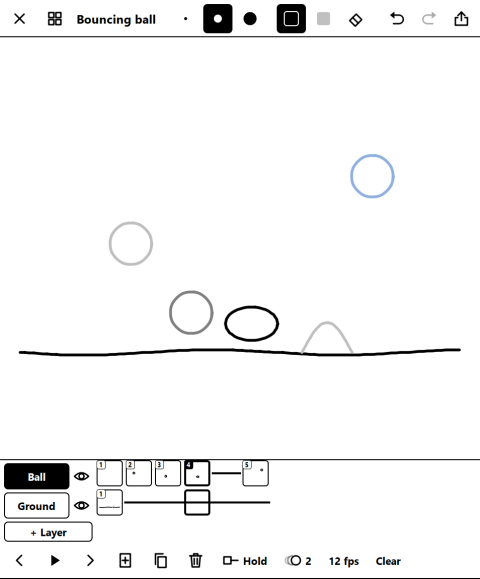
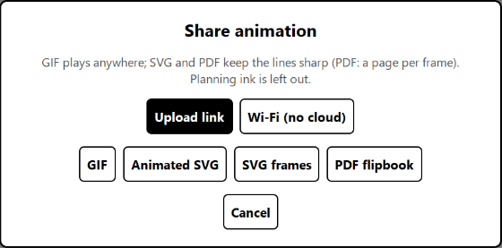
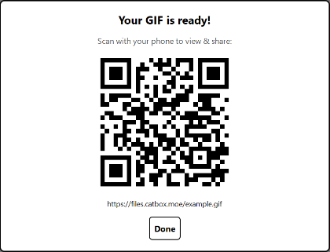

# RemarkableAnimator

Flipbook animation **on** the reMarkable Paper Pro Move and the reMarkable 2: draw frames with the
pen, play them back on the tablet, and share them to your phone via QR code.

<p align="center"></p>

## Examples
Drawn and exported on the tablet with Animator: the same 18-frame animation as a GIF and as an
animated SVG (the SVG stays sharp at any size).

<p align="center">
  
  <br><br>
  
</p>

## Features
- Pressure-sensitive pen in 3 sizes; flip the pen (or tap the eraser button) to erase
- Lasso: loop some strokes, then drag the box to move them
- Rough on its own layer, then tap its eye to fade it to half strength and draw clean on top
  (exports leave a faded layer out; tap again to hide it)
- Up to 3 layers with names; a layer can **Hold** a drawing across frames instead of redrawing it
- Onion skin: earlier drawings in fading grey, the next one in light blue
- Timeline and project list with thumbnails; drag frames to reorder; playback at 6–24 fps
- Undo/redo for strokes and for frame and layer edits (new, copy, delete, move, hold); Delete
  removes only the current layer's drawing
- Rename, delete; everything autosaves on the tablet (works offline)
- Palm rejection: a resting hand can't draw or press the timeline and bottom bar; fingers still
  work on the top bar, keyboard and menus, in case you put the pen down
- Share to your phone with a QR code (see below)

## Sharing
Tap the share button (top right), pick how the link reaches your phone, then a format:

<p align="center"></p>

- **Upload link:** the file is uploaded to [catbox.moe](https://catbox.moe) (anonymous, only when
  you share). To use your own server instead, see [Upload target](#upload-target).
- **Wi-Fi (no cloud):** the tablet serves the file itself for 10 minutes while Animator stays open.
  Your phone must be on the same Wi-Fi.

| Format | Good for |
|---|---|
| **GIF** | Plays anywhere: messages, social posts |
| **Animated SVG** | One small file that loops in any browser and stays sharp at any size |
| **SVG frames** | A zip with one SVG per frame (layers as groups), for Illustrator, Inkscape or Figma |
| **PDF flipbook** | One page per frame; from your phone you can send it to the reMarkable app |

Then scan the code with your phone's camera:

<p align="center"></p>

## On the reMarkable 2
- **Pen booster:** the reMarkable 2's screen is slower, so Animator brings a small add-on that
  draws your pen and eraser through the tablet's own fast pen path, like the notebooks do.
  `deploy.ps1` installs it on a reMarkable 2. It only works on software version 3.29.0.153 and
  switches itself off on any other version: drawing still works then, just with more lag.
- New animations start at 6 fps, which the reMarkable 2 plays evenly.

## What you need
- A reMarkable Paper Pro Move on software version 3.28, or a reMarkable 2 on 3.29.0.153 (the
  versions Animator is tested on)
- A computer and the tablet's USB cable

> [!WARNING]
> **Paper Pro Move: turning on Developer Mode erases your tablet** (it's a factory reset). Back up
> first. Turning it off later is another reset. The reMarkable 2 needs no Developer Mode.
> Modding is at your own risk.

## Install
About 20 minutes the first time. You'll: back up, turn on Developer Mode (Paper Pro Move only), add
the two community tools that let the tablet run apps (XOVI and AppLoad), then copy Animator over.
**Already have XOVI and AppLoad?** Skip to [step 4](#4-install-animator).

| | Paper Pro Move | reMarkable 2 |
|---|---|---|
| Software version | 3.28 | 3.29.0.153 |
| Step 2, Developer Mode | Yes (it resets the tablet) | Skip it |
| Pen booster | Not needed | Step 4 installs it for you |

### 1. Back up your tablet
Let the tablet finish syncing, then check on [my.remarkable.com](https://my.remarkable.com) or in
the reMarkable desktop app that every notebook you care about is there. Anything that isn't will be
gone after step 2.

### 2. Turn on Developer Mode (Paper Pro Move only)
On the tablet, go to **Settings → General → Paper Tablet → Software → Advanced → Developer Mode**.
The tablet resets; set it up again and sign back in. (reMarkable's own guide:
[Developer Mode](https://developer.remarkable.com/documentation/developer-mode).)
On a reMarkable 2, skip this: it's ready as it is.

Now find the tablet's password: **Settings → General → Help → About → Copyrights and Licenses**,
under "General Information" (on a reMarkable 2, look for the same screen under **Help**). The
username is `root`. You'll type this password a few times below.

**Check it works:** plug the tablet into your computer, open a terminal (Windows: PowerShell,
Mac: Terminal) and run `ssh root@10.11.99.1`. Type `yes` if asked, then the password. If you get a
prompt on the tablet, you're in. Type `exit` to leave.

### 3. Install XOVI and AppLoad
These community tools let the tablet run extra apps like this one. Follow their guides:
first [install XOVI](https://github.com/asivery/rm-xovi-extensions#to-install-xovi), then
[AppLoad](https://github.com/asivery/rm-appload).

### 4. Install Animator
1. On this page, click the green **Code** button → **Download ZIP**, and unzip it.
2. Plug the tablet in by USB.
3. Open a terminal in the unzipped folder and copy the app over. It will ask for the tablet's
   password several times; that's normal.
   - **Windows** (right-click inside the folder → **Open in Terminal**):
     ```powershell
     powershell -ExecutionPolicy Bypass -File .\deploy.ps1 -Restart
     ```
   - **Mac / Linux:**
     ```bash
     ssh root@10.11.99.1 mkdir -p /home/root/xovi/exthome/appload/RemarkableAnimator
     scp -r src/* root@10.11.99.1:/home/root/xovi/exthome/appload/RemarkableAnimator/
     ssh root@10.11.99.1 "chmod +x /home/root/xovi/exthome/appload/RemarkableAnimator/backend/entry /home/root/xovi/exthome/appload/RemarkableAnimator/backend/*/entry && systemctl restart xochitl"
     ```
     On a reMarkable 2, also add the pen booster before that last line:
     ```bash
     ssh root@10.11.99.1 "cp /home/root/xovi/exthome/appload/RemarkableAnimator/extension/animator-ink.so /home/root/xovi/extensions.d/.animator-ink.new && mv -f /home/root/xovi/extensions.d/.animator-ink.new /home/root/xovi/extensions.d/animator-ink.so"
     ```
4. The tablet's screen reloads. Open the AppLoad menu and tap **Animator**. 🎉

### If something goes wrong
- **Animator vanished after the tablet restarted:** XOVI switches itself off on every restart
  (on purpose, so a bad mod can't trap your tablet). Plug in, `ssh root@10.11.99.1`, and run
  `xovi/start`.
- **After a reMarkable software update:** updates switch the mods off, and AppLoad has to support
  the new version, so hold off on updating if you can. To turn them back on, repeat
  [step 3](#3-install-xovi-and-appload). On a reMarkable 2 the pen booster stays off on a new
  version until Animator supports it.
- **Remove the pen booster (reMarkable 2):** `ssh root@10.11.99.1`, then
  `rm /home/root/xovi/extensions.d/animator-ink.so && systemctl restart xochitl` (close Animator
  first).
- **Updating Animator:** first close Animator on the tablet with its ✕ (restarting the tablet's UI
  while the app is open can crash it), then download the new ZIP and repeat step 4. Your
  animations are kept.

## Upload target
Exports go to catbox.moe by default (anonymous, no account). To use your own server, create
`/home/root/.local/share/remarkable-animator/settings.json` on the tablet:
```json
{ "upload": { "url": "https://example.com/upload", "field": "file", "params": {} } }
```
The response may be plain text containing the link, or JSON with a `url` field.

## Build
```powershell
# Backend (pen pressure, Wi-Fi share): static binaries via zig (winget install zig.zig), one per
# tablet CPU; src/backend/entry is a script that starts the right one
zig cc -target aarch64-linux-musl -O2 -static -s -o src/backend/aarch64/entry backend/pen.c backend/share.c
zig cc -target arm-linux-musleabihf -mcpu=cortex_a7 -O2 -static -s -o src/backend/armv7l/entry backend/pen.c backend/share.c
# reMarkable 2 pen booster (a XOVI extension). extension/xovi.c is generated by XOVI's
# util/xovigen.py from extension/animator-ink.xovi
zig cc -target arm-linux-gnueabihf.2.31 -mcpu=cortex_a7 -shared -fPIC -O2 -s -o src/extension/animator-ink.so extension/animator-ink.c extension/xovi.c -ldl -lpthread
# QML resources, with PySide6's rcc
rcc --binary src/resources.qrc -o src/resources.rcc
# Close the app on the tablet, then copy and restart xochitl (AppLoad caches the app until then)
.\deploy.ps1 -Restart
```
Machine-specific deploy settings (tablet Wi-Fi IP, an SSH askpass helper) go in a git-ignored
`deploy.local.ps1`; see the top of `deploy.ps1`.

## How it works
The reMarkable's UI imposes some surprising constraints (the pen arrives as a mouse, the e-ink
renderer can't draw vector shapes, a one-minute watchdog). [docs/ARCHITECTURE.md](docs/ARCHITECTURE.md)
explains them and how the app works around each.

## License
[MIT](LICENSE)
